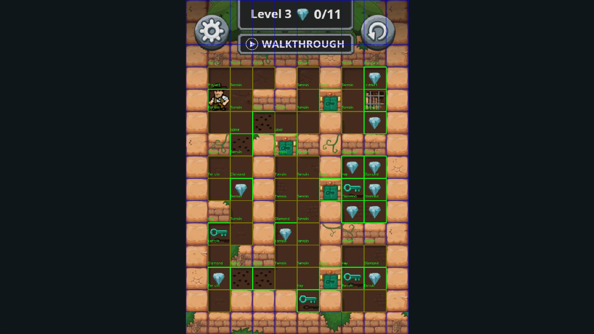

# Diamond Rush Bot

[](https://www.python.org/downloads/)
[](#requisitos)
[](#estado)

Bot que juega **Diamond Rush** de [Minijuegos](https://www.minijuegos.com) en el navegador. Lee la pantalla con **visión por computador**, reconstruye el tablero y calcula con **A\*** la ruta con el **menor número de pasos** para resolver cada nivel; después la ejecuta pulsando las flechas del teclado.

Hasta ahora ha completado los **niveles 1 a 20** en el juego real, encadenados con `--loop`.

> Este proyecto parte de [SebMatDo/Diamond-Rush-Bot](https://github.com/SebMatDo/Diamond-Rush-Bot) (visión y un agente codicioso). Aquí se añadieron el solucionador óptimo, la lectura de la cabecera y el historial de intentos. El agente codicioso original se conserva en el tag `v0.1-estable`.

## Contenido

- [Cómo funciona](#cómo-funciona)
- [Requisitos](#requisitos)
- [Instalación](#instalación)
- [Uso](#uso)
- [Reglas del juego modeladas](#reglas-del-juego-modeladas)
- [Estructura del proyecto](#estructura-del-proyecto)
- [Estado](#estado)
- [Limitaciones](#limitaciones)
- [Demo](#demo)

## Cómo funciona

1. **Captura y visión** (`diamond_rush_vision.py`): toma una captura con `pyautogui`, localiza el área de juego y detecta cada celda por *template matching* con las plantillas de `objects_in_game/`. El tablero es una cuadrícula de 15 x 10; las 2 primeras filas son la cabecera y el tablero real son las filas 2 a 14 (13 x 10).
2. **Identificación del nivel** (`hud_reader.py`, `nivel.py`): lee "Level N" y los diamantes recogidos de la cabecera sin OCR, con plantillas de dígitos (`hud_digits/`). Así sabe cuántos diamantes faltan. Si no puede leerla, compara el mapa con los niveles conocidos.
3. **Solucionador óptimo** (`diamond_solver.py`): A\* sobre macro-movimientos con heurística de árbol de expansión mínima (admisible y consistente). El coste es el número de pasos. Devuelve una cadena como `"UDLR..."`.
4. **Caché de niveles** (`known_levels.py`, `bot_solver.py`): guarda los niveles 1-20 con su solución óptima, que sirve de caché y de prueba de regresión. Si el A\* óptimo agota el tiempo, reintenta con A\* ponderado y la ruta puede no ser la más corta.
5. **Ejecución** (`main.py`): pulsa las flechas con una pausa por paso y, en modo `--loop`, comprueba en la cabecera si el juego pasó al nivel siguiente.
6. **Historial** (`historial.py`): guarda cada intento en `historial_intentos.jsonl` (nivel, ruta, retardo, resultado, versión de git).

## Requisitos

- **Python 3.10 o superior** (el código usa `match` y `X | None`).
- **macOS**. Se desarrolló y probó en un MacBook con pantalla Retina; `requirements.txt` incluye `pyobjc`.
- Permisos de macOS para la app de terminal: **Accesibilidad** (enviar teclas) y **Grabación de pantalla** (capturas). Tras concederlos, cierra la app con ⌘+Q y ábrela de nuevo.

## Instalación

```bash
git clone https://github.com/jrodriguezleo/DiamondRushSolver.git
cd DiamondRushSolver
python3.12 -m venv venv
source venv/bin/activate
pip install -r requirements.txt
```

Si mueves o renombras la carpeta, recrea el entorno virtual (guarda rutas absolutas).

## Uso

Abre el juego en el navegador, deja el tablero completo y visible, y ejecuta desde la terminal. Tienes unos segundos (`--countdown`, 3 por defecto) para volver a enfocar el navegador.

```bash
# Prueba segura: captura, calcula y muestra la ruta SIN pulsar teclas
python main.py --dry

# Resolver el nivel que haya en pantalla
python main.py

# Encadenar niveles sin preguntar nada
python main.py --loop --delay 0.3
```

El retardo por defecto es 0.25 s por paso. Si el juego pierde pulsaciones, usa `--delay 0.3`.

### Opciones de `main.py`

| Opción | Qué hace |
|---|---|
| `--dry` | Solo calcula y muestra; no pulsa teclas ni guarda historial. |
| `--loop` | Encadena niveles sin preguntar: tras cada uno lee la cabecera, registra `ok` si cambió de nivel y se detiene si no. |
| `--max-niveles N` | Con `--loop`, para tras N niveles (0 = sin límite). |
| `--wait S` | Con `--loop`, pausa tras detectar el nivel nuevo (3 s). |
| `--timeout-siguiente S` | Con `--loop`, espera máxima a que la cabecera cambie (25 s). |
| `--level N` | Juega la solución guardada del nivel N, sin visión. |
| `--candidata` | Con `--level`, prueba la ruta candidata del A\* si el nivel la tiene. |
| `--verificar "DDLR..."` | Con `--level`, simula una ruta a mano y la juega (con `--dry` solo simula; `--traza` muestra cada paso). |
| `--needed N` | Fuerza cuántos diamantes faltan. |
| `--spikes once\|floor\|wall` | Cómo tratar los pinchos (por defecto `once`: se pisan una vez). |
| `--delay S` | Segundos por paso (0.25). |
| `--countdown S` | Segundos de espera antes de capturar (3). |
| `--max-seconds S` | Tiempo máximo de búsqueda del A\* (120). |
| `--historial` | Muestra el resumen de intentos y sale. |
| `--no-historial` | No pregunta ni guarda el resultado. |

Fuera de `--loop`, al terminar el bot pregunta si la ejecución fue correcta y lo anota en el historial.

### Depuración con capturas

`screenshots/Levels/` contiene una captura por nivel para probar la visión sin el juego abierto:

```python
from diamond_rush_vision import DiamondRushVision

vision = DiamondRushVision()
grid = vision.debug_mode("screenshots/Levels/Level 1.png")
```

Con `show_image=True` se abre una ventana con las celdas etiquetadas. Esa ventana se cuela en la siguiente captura y confunde la detección, así que en tiempo real usa `show_image=False`.



## Reglas del juego modeladas

Confirmadas jugando en el juego real:

- Las paredes y la lava bloquean. Una roca se empuja si la casilla siguiente está libre; en un hoyo lo rellena.
- Se lleva como máximo una llave, y la puerta la consume al abrirse.
- La salida se abre al reunir los diamantes que indica la cabecera (puede ser menos que el total, como en el nivel 6). En el nivel 20 la salida es un tótem y no hay diamantes.
- Un **pincho** se pisa una sola vez y al salir se levanta. Una roca empujada encima lo desactiva.
- Cada **placa** abre **una** valla concreta. Una roca sobre la placa la mantiene pulsada, y el jugador de pie sobre ella también. Una roca se puede empujar sobre una valla abierta.

## Estructura del proyecto

```
DiamondRushSolver/
├── main.py                    # CLI y bucle de juego
├── diamond_rush_vision.py     # Captura y detección de celdas
├── hud_reader.py              # Lectura de "Level N c/N" de la cabecera
├── build_hud_templates.py     # Genera las plantillas de dígitos (hud_digits/)
├── nivel.py                   # Identificación del nivel (cabecera + mapa)
├── bot_solver.py              # Puente visión -> layout y caché
├── diamond_solver.py          # A* óptimo y simulador de rutas
├── known_levels.py            # Niveles 1-20 y sus soluciones
├── historial.py               # Registro de intentos (historial_intentos.jsonl)
├── objects_in_game/           # Plantillas de objetos para la visión
├── hud_digits/                # Plantillas de dígitos de la cabecera
├── screenshots/               # Plantillas y capturas de cada nivel (Levels/)
└── readme_screenshot/         # Imagen de este README
```

Código heredado del agente codicioso original, que `main.py` ya no usa (se mantiene como referencia): `smart_agent.py`, `game_state.py`, `a_star.py`, `rock_simulation.py` (su simulación de rocas es defectuosa), `keyboard_simulator.py`, `cell.py` y `game_action.py`.

## Estado

- **Niveles 1 a 20 completados** en el juego real con `python main.py --loop --delay 0.3`.
- El A\* óptimo reproduce la longitud mínima de las soluciones conocidas. El nivel 11 es el más lento (72 pasos, unos 224 s); el resto tarda entre décimas de segundo y unos 7 s.
- Pendiente: tests automáticos, mejorar la detección (falsos pinchos, fila tapada por la cabecera, lava) y probar las rutas candidatas más cortas de los niveles 3 y 10.

## Limitaciones

- La visión usa *template matching*: depende de la resolución y de que el tablero esté completo, visible y sin superposiciones. Con el juego muy pequeño en pantalla la cabecera no se lee y el bot recurre al mapa.
- Pensado para la versión web estándar de Minijuegos; no aprende ni se adapta, la lógica está programada.
- Solo se ha probado en macOS con pantalla Retina.
- El repositorio no incluye un archivo `LICENSE`. Antes de redistribuir el código conviene revisar la licencia del proyecto original.

## Demo

Demo del proyecto original (agente codicioso):

[](https://youtu.be/J1k1kEa-UyU)
